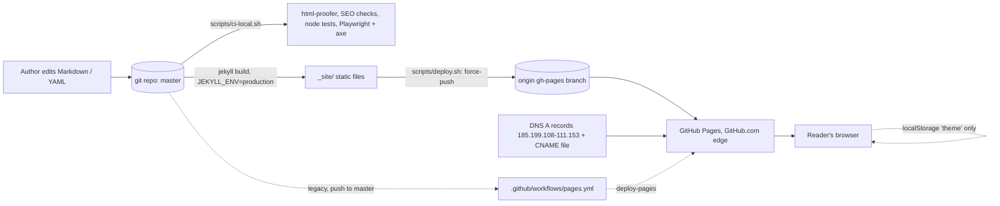

# pmn.nz architecture

pmn.nz is a static personal notebook (posts, book notes, projects, fails). It has no server code, so most of the usual architecture headings are empty. This page says so explicitly and records what exists.

## Services

None. Jekyll 4 builds the site once; GitHub Pages serves the output as static files. Plugins: jekyll-feed, jekyll-seo-tag, jekyll-sitemap, jekyll-redirect-from, jekyll-include-cache. Ruby `>= 3.3.0` (`.ruby-version` and pages.yml stay on 3.3).

## Routes (all static, `permalink: pretty`)

| Route | Source |
|---|---|
| `/` | `index.md` |
| `/about/`, `/cv/`, `/blog/`, `/books/`, `/projects/`, `/fails/` | the matching `*.md` |
| `/blog/:year/:month/:day/:title/` | `_posts/` (10 posts) |
| `/books/:name/` | `_books/` (23 book notes), listed from `_data/books.yml` and `books_backlog.yml` |
| `/feed.xml`, `/sitemap.xml` | jekyll-feed, jekyll-sitemap |
| `/404.html` | `404.html` (served by GitHub Pages for unknown paths) |

There is no `robots.txt`. Layouts are in `_layouts/` (default, page, post, book) and `_includes/` (head, sidebar). Client JS is two small files in `assets/js/`: `theme-toggle.js` and `image-modal.js`. Fonts (Fraunces, Inter) and CSS (`assets/css/site.css`) are self-hosted.

## Data stores

- Content: Markdown and YAML in git (`_posts`, `_books`, `_data`). Git is the only store.
- Browser: one `localStorage` key, `theme` (light/dark/system), written client-side in try/catch. Nothing is sent to a server.
- No database, cache, session, cookie or stored secret.

## Queues

None.

## External dependencies

- Runtime: none for page loads (no third-party scripts, fonts, analytics or embeds). The sidebar links out to `https://panashe.nz`.
- GitHub: hosts the repo and serves Pages (no custom headers, so no CSP/HSTS possible; see the Inbox decision in `.tracking.md`).
- DNS for `pmn.nz`: A records to GitHub Pages, plus the `CNAME` file in the repo (deploy.sh refuses to deploy without it).
- Build/test only: RubyGems (Jekyll and plugins, html-proofer), npm (`@playwright/test`, `@axe-core/playwright`), Playwright's Chromium download.

## Deploy targets and machines

- Target: GitHub Pages for `anphase/pmn.nz`. Intended path: `scripts/deploy.sh` builds locally and force-pushes `_site` plus `.nojekyll` to `gh-pages` (`DEPLOY_DRY_RUN=1` builds without pushing). This needs the Pages source set to "Deploy from a branch: gh-pages", which is an owner setting.
- Legacy path: `.github/workflows/pages.yml` builds and deploys on push to `master` on a GitHub-hosted `ubuntu-latest` runner. It stays until the owner switches the Pages source; the deploy entry in `.tracking.md` tracks this.
- Machines: any fleet machine with Ruby >= 3.3 and git credentials for origin runs the deploy; checks (`scripts/ci-local.sh`) also need Node and Chromium. No servers or long-running hosts.
