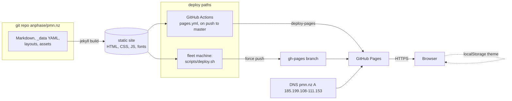

# pmn.nz architecture

pmn.nz is a static personal notebook (posts, book notes, projects, fails) built with Jekyll 4. There is no server-side code at runtime, so several of the categories below are deliberately empty.

## Services

| Service | What it is |
|---|---|
| Jekyll build | `bundle exec jekyll build` (`JEKYLL_ENV=production`), Ruby >= 3.3.0, plugins jekyll-feed, jekyll-seo-tag, jekyll-sitemap, jekyll-redirect-from. Output is plain HTML, CSS, JS and fonts. |
| GitHub Pages | Serves the built files for https://pmn.nz (`server: GitHub.com`). The only runtime. |
| Browser JS | `assets/js/theme-toggle.js` (Light/Dark/System, choice kept in `localStorage`), `assets/js/image-modal.js`. A pre-paint inline script in `_includes/head.html` applies the theme. |

No API, database, worker, auth or queue exists.

## Routes (all static)

| Route | Source |
|---|---|
| `/` | `index.md` |
| `/blog/` | `blog.md` |
| `/blog/:year/:month/:day/:title/` | `_posts/` (collection permalink) |
| `/books/` | `books.md`, data from `_data/books.yml` |
| `/books/:name/` | `_books/` (collection permalink) |
| `/projects/`, `/fails/`, `/about/`, `/cv/` | `projects.md`, `fails.md`, `about.md`, `cv.md` |
| `/feed.xml`, `/sitemap.xml`, `/robots.txt` | jekyll-feed, jekyll-sitemap, build |
| `/404.html` | `404.html` |
| redirects | jekyll-redirect-from stubs (`redirect_from:` front matter) |

Layouts: `_layouts/{default,page,post,book}.html`; includes `head.html`, `sidebar.html`. CSS is one file, `assets/css/site.css`; fonts (Fraunces, Inter) are self-hosted woff2 in `assets/fonts/`.

## Data stores

None at runtime. Content lives in git: Markdown in `_posts/`, `_books/` and the root pages; YAML in `_data/` (`books.yml`, `books_backlog.yml`). The browser stores only the theme choice in `localStorage`. The tracked `_site/` is build output and is not the deploy source.

## Queues

None.

## External dependencies

- GitHub (repository `anphase/pmn.nz`, Pages hosting, the `gh-pages` branch).
- DNS for pmn.nz: A records 185.199.108-111.153 (GitHub Pages) and the `CNAME` file `pmn.nz`; managed outside this repo.
- Build/test only: RubyGems (Gemfile, html-proofer in the `:test` group), npm (`@playwright/test`, `@axe-core/playwright`).
- Links to third-party sites in posts (checked, see `docs/quality/links.md`); `panashe.nz` is linked from the sidebar. No third-party scripts, fonts or analytics load at runtime.

## Deploy targets and machines

| Path | How |
|---|---|
| Fleet deploy (intended) | `bash scripts/deploy.sh` on any fleet machine with Ruby: builds, refuses without `CNAME`, adds `.nojekyll`, force-pushes the output to `gh-pages` on origin. Needs the GitHub Pages source set to "Deploy from a branch: gh-pages" and `pmn.nz` set in the coordinator `config/ship.json`; both are owner steps (see `.tracking.md` Inbox). `DEPLOY_DRY_RUN=1` builds without pushing. |
| GitHub Actions (current) | `.github/workflows/pages.yml` on push to `master` or manual dispatch: ubuntu-latest, build, `upload-pages-artifact`, `deploy-pages`. To become manual-only once the fleet deploy is proven. |
| Local checks | `bash scripts/ci-local.sh` (build to a temp dir, html-proofer, SEO check, perf assets, node tests, Playwright e2e). Runs on any dev machine or fleet worker. |

There is no machine that hosts pmn.nz itself; GitHub's infrastructure serves it.

## Diagram

